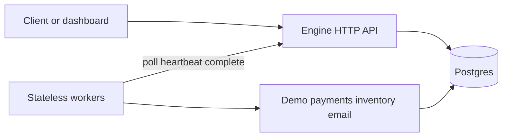

# Architecture

Durable Flow is a small durable-execution engine: workflow code is ordinary Go, progress lives in Postgres, and workers are disposable.

## Components

| Piece | Role |
|-------|------|
| **Engine** (`cmd/engine`, `internal/`) | Accepts starts, leases tasks, appends history, runs the reaper and timer scheduler. Single writer to durable state. |
| **Postgres** | Source of truth: workflows, append-only events, tasks (also the queue via `FOR UPDATE SKIP LOCKED`), timers, workers. |
| **Workers** (`sdk/worker`, `cmd/demo-worker`) | Poll for work. Replay workflow functions against history. Run activities and heartbeat while leased. |
| **SDK** (`sdk/`) | Public API for workflow/activity code and a thin HTTP client. Scenarios import this only. |
| **Demo services** (`cmd/demo-services`) | Fake payments, inventory, email, accounts. Idempotency keys live here so duplicate activity attempts do not double-charge. |
| **Dashboard** (`dashboard/`) | Next.js UI. Browser talks only to Next.js; the server proxies to the engine with the demo key. |

## Request flows

### Start a workflow

1. Client `POST /v1/workflows` with type and input.
2. In one transaction the engine inserts the `workflows` row, appends `WorkflowStarted`, and enqueues one workflow task.
3. A worker eventually leases that task and runs the workflow function in replay mode.

### Replay and schedule an activity

1. Worker leases a workflow task and receives history plus `history_len` at dispatch.
2. The SDK re-runs the workflow from the top. Completed steps return recorded results; the next unfinished step emits a command (for example `ScheduleActivity`) and stops.
3. Worker reports commands. Engine verifies lease token and history length, appends events, inserts activity tasks or timers, all in one transaction.

### Run an activity

1. Worker leases an activity task, runs the Go function, heartbeats while it runs.
2. On success it posts the result with the lease token. Engine appends `ActivityCompleted` and enqueues the next workflow task so replay can continue.
3. On application failure the engine schedules a retry (burn an attempt) or fails the workflow. Lease expiry does **not** burn a retry attempt.

### Crash recovery

1. Worker dies or stalls; heartbeats stop.
2. Reaper notices `lease_expires_at` in the past, returns the task to `pending`, bumps the fencing token, appends a lease-expired event.
3. Another worker leases the task. For a workflow task it replays from history. For an activity it runs again with the same idempotency key (`workflowID:commandSeq`).
4. A late complete from the dead worker carries a stale token and is rejected (`StaleCompletionRejected`).

Recovery time is bounded by `LEASE_TTL` plus the worker poll interval.

## Why Postgres is the queue

One system to operate. `SKIP LOCKED` lets many workers dequeue without blocking each other. Throughput is capped by Postgres; that is an accepted trade-off for this educational engine. See [ADR 001](decisions/001-postgres-as-queue.md).

## Invariants (short)

- Event log is append-only; `seq` is contiguous per workflow.
- Every state transition for a workflow locks that workflow row (`SELECT … FOR UPDATE`).
- At most one open workflow task per workflow; at most one open activity task per `(workflow_id, command_seq)`.
- Completions must present the current lease token.
- Commands apply only if history length still matches dispatch (otherwise discard and re-enqueue).
